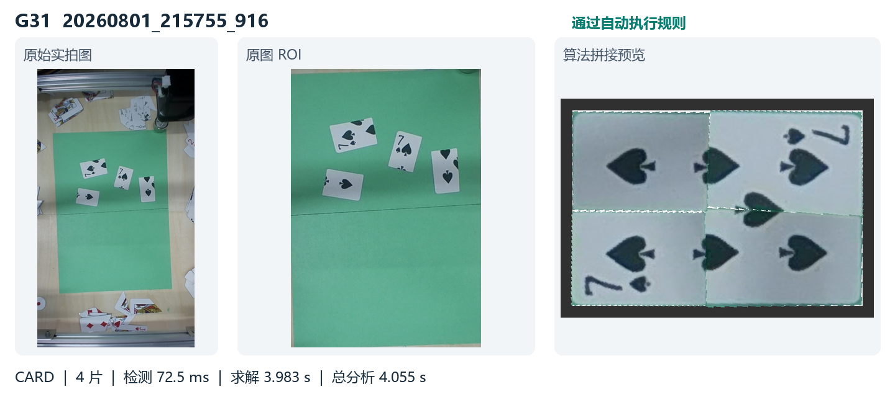
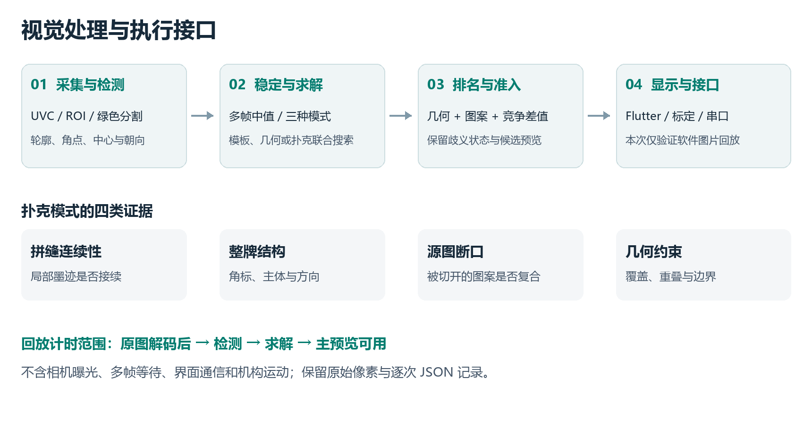

# 拼图装置 · 树莓派 5

绿色背景上的碎片识别、普通矩形重组与扑克图案拼接。当前扑克模式联合比较碎片身份、朝向和邻接，可处理四个相似矩形；求解期间暂停实时视觉计算。

**当前稳定分支 `raspberry-pi5` · 原生 ARM64 编译 · OpenCV / NumPy / C++ / Flutter**

[完整算法说明](docs/VISION_ALGORITHM.md) · [实测数据与全部图像](docs/benchmarks/2026-10-18/README.md) · [部署与回滚](README-PI5.md) · [设计报告 PDF](docs/reports/pi5-design-20261018.pdf) · [可编辑 Word](docs/reports/pi5-design-20261018.docx)



## 最新板端测试

2026-10-18，在真实 Raspberry Pi 5 上重跑 **43 张绿底实拍图**，每张三次，加 10 次扑克负样本，共 **139 次有效运行**。黑色工作背景与遮挡图排除；绿色背景上的深色无印刷碎片保留。

| 分组 | 图片 | 求解中位数 | 总分析中位数 | 总分析单次最大 |
|---|---:|---:|---:|---:|
| 历史扑克 | 31 | 0.774 s | 0.850 s | 4.789 s |
| 全部扑克 含新增两图 | 33 | 0.899 s | 0.973 s | 6.717 s |
| 无印刷碎片 NORMAL | 10 | 0.144 s | 0.276 s | 1.143 s |

中位数先按每图三次计算，再对图片汇总。总分析包含重新检测、求解及主预览生成，不含相机曝光、多帧等待、文件读写、进程启动和机械动作。CARD 求解时间已包含函数内候选渲染，不能与纯搜索耗时等同。

- **回归稳定**：31 张历史扑克 × 3 次，主预览 PNG 与上次参考逐像素一致，状态相同。
- **自动准入**：33 张扑克中 18 张 `VERIFIED`、14 张 `AMBIGUOUS`、1 张 `GEOMETRY_ONLY`。这不是 33 张全部自动通过。
- **普通模式问题**：10 张均为 `BEST` 保底布局，其中 5 张漏检至不足四片。不能把短耗时写成完整拼图成功率。
- **负样本**：10 张无印刷图片按 CARD 测试，自动放行 0 张。
- **资源**：最高温度 50.15°C，所有采样降频标记 `0x0`；测试进程峰值 RSS 126.3 MiB。

完整原图、拼接图、三次耗时及异常均公开保留在[测试档案](docs/benchmarks/2026-10-18/README.md)。离线结果不代替机械抓取、放置精度和整机限时验证。

## 算法怎样工作



1. 自动估计绿色颜色簇，提取碎片轮廓、角点与朝向；在线通过多帧匹配与中值稳定轮廓。
2. FIRST 匹配已学习的目标模板；NORMAL 搜索几何矩形；CARD 生成纸角、扇形、条带、矩形拓扑或邻接图候选。
3. 用拼缝连续性、角标、主体图案及源图断口评价候选；始终保留每片的真实身份和方向。
4. 结合几何约束、印刷置信度和竞争差值，输出首选、候选列表及自动执行状态。
5. 由六点标定映射至平台坐标，通过串口协议连接下位机。当前报告不宣称完整机械闭环已通过。

没有使用 OCR、神经网络或 NPU；具体缓存、剪枝、评分权重和准入条件见[算法说明](docs/VISION_ALGORITHM.md)。

## 构建与运行

在树莓派桌面终端执行，使用当前稳定分支：

```bash
git clone --branch raspberry-pi5 https://github.com/chaoxiaohan/26-E-Puzzle-Device.git
cd 26-E-Puzzle-Device
bash deploy_pi5.sh --check
bash deploy_pi5.sh --prepare-only
```

准备完成后按[部署文档](README-PI5.md)切换发布目录。既有设备保留参数、原程序备份及照片；不要用仓库默认 JSON 覆盖现场标定。日常启动：

```bash
bash "$HOME/puzzle_flutter_ui/start_ui.sh"
```

## 目录与版本

| 路径 | 内容 |
|---|---|
| `puzzle_card_detector/` | 检测、求解、图案、标定、串口及桥接 |
| `puzzle_flutter_ui/` | Flutter 控制界面 |
| `tools/` | 部署、回归与板端基准工具 |
| `docs/VISION_ALGORITHM.md` | 当前完整视觉算法说明 |
| `docs/benchmarks/2026-10-18/` | 43 张原图、输出、图集及数据 |
| `docs/reports/` | Word 与 PDF 设计报告 |

`lubancat-1` 保留鲁班猫平台版本，`raspberry-pi5-adapt-20261016` 保留树莓派适配开发记录；`main` 是项目导航和旧目录结构，不作为本次安装入口。升级前快照为 `backup/pi5-before-adapt-20261016`，本次文档工作前快照为 `backup/pi5-before-report-20261018`。

本次没有修改板端运行算法、标定或 ROI。运行代码基线 `02505cf`，算法基线 `6de9e25`；原生构建、真实相机和只读串口记录见 [2026-10-16 板端验证](docs/pi5-board-validation-20261016.json)。
