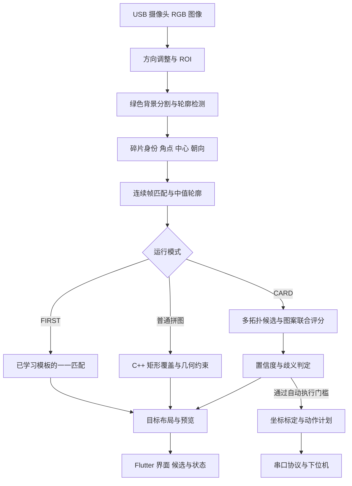
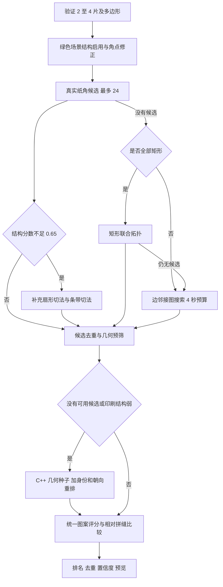

# 拼图装置视觉算法说明

本文对应 `raspberry-pi5` 当前部署算法，运行代码基线为 `02505cf`，与鲁班猫算法基线 `6de9e25` 一致。2026 年 10 月 18 日补充测试与文档，未修改识别算法或现场参数。

系统使用 OpenCV、NumPy、Python 和原生 C++ 求解器。扑克模式把碎片身份、朝向、邻接关系和印刷图案一起比较，因此允许多个碎片形状相同；没有使用神经网络、OCR 模型或 NPU。它是针对少量平面碎片的有限候选搜索与可解释评分，不保证任意图案、任意切法的全局最优解。

[返回项目首页](../README.md) · [树莓派部署](../README-PI5.md) · [本次测试](benchmarks/2026-10-18/README.md)

## 1 系统数据流

在线与离线的边界：在线流程包含相机读取、多帧稳定、进程调度和界面更新。本次图片基准从保存的原始照片重新检测，再调用实际求解函数；不包含相机曝光、多帧等待、串口传输和机械运动。因此报告中的秒数是软件分析时间，不是整机完成时间。

## 2 图像采集与绿色背景分割

### 2.1 相机与感兴趣区域

`camera_device.py` 优先选择真正的 UVC 采集节点，过滤 ISP、编码器和元数据节点。`main.py` 负责横竖屏方向、ROI 限制、相机重连和照片保存。照片同时记录 ROI、检测参数和原始轮廓，以便离线复现。回放使用拍摄时对应的 ROI，不覆盖用户当前的 ROI。

### 2.2 颜色分割

`detect_pieces` 先保存原始 ROI，另外生成 Gamma 提亮与 CLAHE 处理后的亮度图。绿色分割使用保存的原始 RGB 颜色，避免亮度增强改变绿色阈值；灰度备用路径使用 Gaussian 模糊及 Otsu 或手动阈值。

自动绿色阈值流程如下：

1. 以 3 像素步长采样 ROI，在 HSV 和绿色通道占比约束下选择绿色候选。
2. 平滑色相直方图并找主峰，在主峰附近选择颜色簇。
3. 由色相中值、偏差分位数，以及饱和度、亮度的低分位数确定阈值。
4. 在线传入状态时，颜色簇变化较小则以旧值 0.82、新值 0.18 平滑；独立图片回放没有跨帧状态。
5. 在 `green_background_foreground_mask_v2` 中得到背景/纸片掩膜，按配置进行形态学处理。样本不足时回退到固定绿色规则。

当前现场参数允许关闭闭运算，避免把相邻碎片粘在一起。绿色方法、阈值、面积过滤参数仍保留在设置文件中。

### 2.3 轮廓与角点

`find_candidates` 提取外轮廓，按面积、ROI 边缘距离、尺寸和实心度筛选；对疑似相连的复杂轮廓尝试分离。`approximate_piece_polygon` 与 `refine_polygon_corners` 将边界简化为多边形，并利用长直边恢复角点，减少切边锯齿的影响。

输出包含 `points`、`center`、`area`、`solidity`、`angle` 等字段。最多保留四片，按中心的纵横坐标排序；这个临时编号只表示当前帧中的实体身份，不表示牌面位置。

扑克路径还会调用 `refine_card_piece_geometry`：对四片场景中的四边形，用原始轮廓的直线拟合与交点改善测量。只有角点漂移、面积比例和顶点方向检查通过才接受修正。算法不会因为四个碎片长得一样就把它们当成同一个实体。

## 3 在线稳定识别

最近两秒的检测进入历史队列。`build_stable_piece_set` 从最近八帧中选择相同顶点数量组合，枚举实体对应关系，要求对应中心位移不超过 12 像素；最多采用五组、至少需要三组。

对顶点顺序进行循环/方向对齐，计算中值轮廓，再用 MAD 思路剔除异常样本。顶点离散度和面积波动超限时继续等待；超时后的保底路径由主状态机标明。这一步用于抑制视频噪声，单张照片基准不模拟重复的“伪视频帧”。

## 4 三条求解路径

| 模式 | 输入知识 | 核心处理 | 结果含义 |
|---|---|---|---|
| FIRST 模板模式 | 事先学习的目标布局 | 形状、轮廓姿态、面积、纹理的一一分配 | 回到学习位置 |
| 普通拼图 | 当前碎片多边形 | 矩形覆盖搜索及几何修复 | 形成矩形或保底布局 |
| CARD 扑克模式 | 当前多边形与真实像素 | 候选拓扑、拼缝、角标、主体、断口联合比较 | 输出首选预览及自动执行判断 |

### 4.1 已知目标的模板模式

`template_matcher.py` 保存每片的图像块、掩膜、轮廓、中心和面积。匹配时计算 Hu 形状相似度、轮廓旋转对应、面积比例、旋转相关纹理；当前权重分别为 0.30、0.40、0.20、0.10。四片时枚举最多 24 种一一分配。

匹配后通过刚体旋转和平移把当前片放回对应模板中心。该路径在 FIRST 模式且已有模板时启用，不是扑克模式识别花色/点数的训练库。本次历史照片没有逐例配套的学习过程，因此未将 FIRST 模板命中率纳入图片基准。

### 4.2 普通矩形拼图

`solve_piece_set_worker` 首先调用 `cpp_rectangle_solver.py` 连接原生 `rectangle_solver.cpp`。碎片缩放到求解栅格后，C++ 用扫描线生成 64 位位集，快速计算覆盖与重叠；多个宽高比由两个工作线程分配搜索。

当前枚举 11 个宽高比，包括 10/6、1.45、1.50、1.40、1.60、1.80、2.00、1.20、2.20、1.00、2.40。外层按填充率/位置步长逐级尝试 `(0.96,4)`、`(0.88,4)`、`(0.80,3)`、`(0.72,2)`，并进行连续坐标的边界与重叠检查。

严格布局不可用时会保留评分较高的无重叠布局，或尝试 Python 覆盖、其他几何构造与最终保底。`BEST` 等保底状态必须与严格矩形状态分开记录；“有图”不等于满足赛题全部几何要求。

### 4.3 扑克候选的生成顺序

四个相同矩形存在多种排列和半转方向，仅靠轮廓不能判断哪一片应在左上角。当前方法在候选中保留每片的编号和顶点对应关系，再用图案选择排列。`layout_pose_key` 只消除整幅布局共同的旋转和平移，不会把单片旋转 180 度错误地归并成同一解。

主分支包括 `card_corner_solver.py`、`card_fan_solver.py`、`card_strip_solver.py`、`card_joint_solver.py` 和 `card_graph_solver.py`。有限候选池与时间预算限制了搜索规模；C++ 是必要时的候选来源，扑克模式并非必须先找到唯一的几何答案。

## 5 图案如何评分

### 5.1 拼缝的局部连续性

`card_face_solver.py` 沿边固定采样 96 个位置，向纸片内侧取六层带状像素。比较器主要利用最近两层，提取灰度、暗度、饱和度、红色、黑色和沿边梯度；一次向量化比较七个沿边错位量。

评分同时考察边界差异、两侧变化趋势、无法解释的断裂和墨迹不匹配。绿色边缘被剔除。没有墨迹的白边返回中性分数和低证据，不能仅因为“两边都白”就认定拼缝正确。

`relative_texture_matches` 再比较同一边与其他边的匹配情况，将绝对质量和双向相对质量按 0.45 与 0.55 混合。这样既看是否连续，也看该邻居是否比竞争邻居更合理。

### 5.2 整张牌的结构证据

`card_structure.py` 按每片纸面的白色参考归一化颜色，提取墨迹、红色、彩色和边框平面。结构评估保持实体的旋转和平移对应，拒绝反射；渲染分辨率可以统一缩小，但不会为评分把单片拉伸成理想形状。

| 证据 | 实现方式 | 要解决的错误 |
|---|---|---|
| 外边界 | 统计边界附近印刷截断，并追踪源图中被裁切的连通分量 | 半个花色被错误放到整牌外侧 |
| 角标 | 比较角落的字形/花色连通分量、方向、相对布局与对角对应 | 同形碎片方向颠倒，角标跑进牌中间 |
| 主体 | 重复花色的形状关系与排列规律，或人物牌的结构特征 | 点数图案散乱或主体错位 |
| 断口完整性 | 跟踪源连通分量的切口采样，检查拼后能否由其他片接续 | 图案边缘被截断但局部白边仍得高分 |
| 字母串 | 在主体未知时分析细长字符组件及相对位置 | JOKER 类文字牌缺少常规点数角标 |

这里的“字形”和“字母串”是轮廓/连通分量启发式，不输出 OCR 文本，也不声称识别出确定牌名。

结构分数按各项置信度加权：外边界 0.45、角标 0.35、主体 0.20、断口 0.25，再归一化；最后按墨迹证据和刚体姿态误差把弱证据向 0.5 收缩。这些值不是四项相加等于 1 的固定百分比。

### 5.3 总排名

联合搜索默认基础分由纹理 0.78、覆盖 0.055、内部边匹配 0.045、整体图案 0.08、角标 0.04 组成，边界附加权重当前为 0。结构置信度达到 0.25 时，将基础分与结构分按 0.45/0.55 融合。

评分配置仅在 `card_scoring_version == 2` 时载入，旧版磁盘权重保留但不会误用于新算法。分数用于排序，不能解释成统计学上的正确概率。

## 6 歧义与自动执行门槛

`select_card_candidate` 在去除等价整体姿态后比较首选和竞争方案。普通纹理准入要求：纹理置信度至少 0.30、纹理分至少 0.62、覆盖至少 0.84、内部匹配至少 0.55、外侧参与比例至少 0.999，并满足排名和纹理差值均至少 0.025，或满足严格的唯一几何搜索条件。

结构分支还要求足够墨迹，且不能存在高置信度的外边截断、角标错位或断口未接续。也可在更严格的几何条件与强结构证据下通过：覆盖至少 0.88、重叠不超过 0.008、角标与主体满足各自门槛，首选差值至少 0.025。完整逻辑以 `main.py::select_card_candidate` 为准。

| 状态 | 解释 | 如何使用 |
|---|---|---|
| VERIFIED | 当前规则允许自动执行 | 仍需标定、串口和机械条件有效 |
| AMBIGUOUS | 有候选，但竞争方案差异或证据不足 | 显示预览和候选，检查/重新采图 |
| WEAK_TEXTURE | 印刷证据不足 | 白纸不应当作已识别的扑克 |
| GEOMETRY_ONLY | 仅有几何预览或几何等级不足 | 不宣称牌面正确 |
| NO_LAYOUT | 未返回可用布局 | 保留原图和失败记录 |

自动执行检查同时要求 `card_status == VERIFIED` 与 `card_execution_ready == True`。人工候选操作与比赛状态机也需要单独分析；本次图片测试没有发送运动命令。

## 7 预览 坐标与执行接口

预览由原图像素重建，不是生成式补图。`render_layout_preview` 对四边形使用透视变换，对其他多边形使用相似变换，把源碎片投影到目标布局；白色矩形底板用于显示。`close_card_pattern_layout` 撤销为机械放置预留的安全缝，方便观察图案。

因此，预览的视觉完整性不能独立证明真实碎片间的物理缝隙或精度。几何检查、图案预览和实际执行坐标必须分别验证。

`serial_protocol.py` 使用六组像素/平台坐标构建二维仿射映射，按最小二乘解出两组线性系数，检查点云分散程度、矩阵退化和比例，并记录 RMS 与最大残差。标定误差是观测量，不能仅凭“标定有效”声称达到毫米级精度。

动作规划从源片中心、目标位置和旋转量形成队列。串口帧包含同步头、命令、标志、序号、长度、负载与 CRC16-CCITT，使用 ACK/NACK 和超时重试。协议详见仓库的[平台串口文档](拼图平台串口通信协议.md)。下位机驱动、电机、吸盘和机构误差不属于本次离线图片测试范围。

## 8 为什么现在更快

1. 先生成有针对性的纸角、扇形、条带候选，避免对所有可能摆放做连续穷举。
2. 用几何约束和可证明的结构分数上界提前剪枝；只在候选不足或结构弱时运行 C++ 几何种子。
3. 每帧复用纸片墨迹、掩膜、连通分量、形状相似度和对称边对缓存；缓存不跨变化的相机帧。
4. 将七个拼缝错位比较向量化；C++ 扫描线位集和两个内部线程减少重复栅格计算。
5. OpenCV 显式限制为一个线程；求解放在单个独立进程。在线求解期间停止相机/检测/JPEG 更新，保留 UI 状态、串口和心跳处理，结束后恢复。常规视觉循环上限为 10 FPS。

这些优化减少无效工作和资源争用，不能由“CPU 占满”推导已经达到算法极限。当前长尾主要仍来自候选数量、模糊印刷证据和几何兜底路径；应先结合逐图日志分析，再比较不同硬件。

## 9 源码索引与验证边界

| 文件 | 主要职责 |
|---|---|
| [`main.py`](../puzzle_card_detector/main.py) | 检测、多帧稳定、模式选择、评分准入、状态机 |
| [`camera_device.py`](../puzzle_card_detector/camera_device.py) | UVC 设备选择与采集 |
| [`card_piece_geometry.py`](../puzzle_card_detector/card_piece_geometry.py) | 纸片直边和角点修正 |
| [`card_corner_solver.py`](../puzzle_card_detector/card_corner_solver.py) | 纸角候选与结构剪枝 |
| [`card_joint_solver.py`](../puzzle_card_detector/card_joint_solver.py) | 矩形切法、身份朝向与拼缝缓存 |
| [`card_graph_solver.py`](../puzzle_card_detector/card_graph_solver.py) | 一般边邻接候选 |
| [`card_structure.py`](../puzzle_card_detector/card_structure.py) | 角标、主体、外边界、断口、字母串 |
| [`card_face_solver.py`](../puzzle_card_detector/card_face_solver.py) | 拼缝采样比较、图案预览 |
| [`rectangle_solver.cpp`](../puzzle_card_detector/rectangle_solver.cpp) | 原生矩形覆盖搜索 |
| [`layout_constraints.py`](../puzzle_card_detector/layout_constraints.py) | 覆盖、边匹配、边界与重叠约束 |
| [`template_matcher.py`](../puzzle_card_detector/template_matcher.py) | FIRST 模板学习与匹配 |
| [`serial_protocol.py`](../puzzle_card_detector/serial_protocol.py) | 标定、协议、状态与动作传输 |
| [`ui_bridge.py`](../puzzle_card_detector/ui_bridge.py) | JSON 状态与 JPEG 画面桥接 |
| [`Flutter main.dart`](../puzzle_flutter_ui/lib/main.dart) | 操作界面与候选显示 |
| [`benchmark_green_images.py`](../tools/benchmark_green_images.py) | 隔离图片回放、分阶段计时和板端资源记录 |

历史样本参与过算法开发，属于回归集；三次重复用于计时稳定性，不是三倍独立识别样本。新两张照片也是同一牌面的近似场景。当前没有逐片精确物理位姿真值、全光照覆盖、未知牌组独立测试或完整机械闭环统计，不能用该数据声称一般化的 100% 准确率。
