# 树莓派 5 绿色实拍图片基准

**2026-10-18 · 43 张图 · 3 次独立重复 · 139 次有效运行**

[项目首页](../../../README.md) · [完整算法](../../VISION_ALGORITHM.md) · [PDF 报告](../../reports/pi5-design-20261018.pdf) · [Word 报告](../../reports/pi5-design-20261018.docx) · [筛选图集 HTML](gallery.html)

HTML 文件需下载本目录后在浏览器打开；GitHub 可直接查看下面的全部配对图。每组图从左至右为完整原图、ROI、算法重建，未手工修补牌面或删除失败样本。绿色背景上的深色碎片属于本次范围，原图中的黑色补边不作为黑底场景。

## 测试方法

从树莓派现有 61 份原始拍摄记录中选择 43 张有效绿色照片。排除 14 张黑底照片和 4 张遮挡图，名单见 [exclusions.json](exclusions.json)。保留原 41 张回归图，再加入两张 2026-10-16 梅花 10 照片。33 张印刷扑克（含 4 张 JOKER）使用 CARD；10 张无印刷片使用 NORMAL，且额外作为 CARD 负样本。

- 各图重新检测，使用自身 ROI 与记录参数；NORMAL 启用界面同款 `short_edge_protection=True`。
- 各次在独立 Python 子进程中运行实际部署函数，并要求原生 `librectangle_solver.so` 加载成功；不启动相机、GUI 或串口动作。
- 主测试每图三次；10 次负样本另外记录。单例上限 120 秒，139 次有效记录均无超时或错误。
- `detect` 仅检测；`solve` 为 worker 调用（CARD 含候选渲染）；`analysis` 从检测开始到主预览可用。NORMAL 的主图渲染单列为 `post_preview`。
- 图像读取、Python 导入、进程启动、导出、实时稳定等待及机构动作不在 `analysis` 内。不要据此声称整机完成时间。
- 每图取三次中位数；汇总组中位数再对每图中位数计算；范围是三次最小至最大。展示总分析耗时居中的那次预览。
- 先有一张扑克预热，不纳入统计。初版 NORMAL 漏开短边保护的 30 次已作废归档，补跑后才形成这里的最终 139 次有效记录。

运行环境与 25 个源码文件对部署基线的哈希核对见 [environment.json](environment.json)。三轮 31 张历史扑克主预览和状态均与 10 月 16 日参考一致；原图哈希写入 [green-cases.json](green-cases.json)。

## 结果边界

33 张扑克：18 VERIFIED、14 AMBIGUOUS、1 GEOMETRY_ONLY；三次主图与状态全部稳定。10 张普通片全部为 BEST，其中 G02、G03、G06、G07 只检出三片，G25 只检出两片，不能计作完整拼图通过。10 次 CARD 负样本为 3 WEAK_TEXTURE、2 GEOMETRY_ONLY、5 NO_LAYOUT，自动放行 0/10。

最高温度 50.15°C，采样降频标记均为 0x0，最大单进程 RSS 126.3 MiB。RSS 不包含完整桌面与系统占用。重复实验用于计时稳定性，不将样本数乘三，也不把回归一致率当成未知牌组准确率。新增两张是同一张牌的近似场景，不能视为充分独立的新测试集。

## 数据下载与复现

[逐图 CSV](per-image.csv) · [139 次逐次 CSV](all-trials.csv) · [汇总 JSON](summary.json) · [139 次完整 JSON 压缩包](trials.json.gz) · [原始 PNG](originals/) · [重建 PNG](assembled/) · [选中运行 JSON](records/)

在已部署的树莓派上，关闭实时拼图程序后运行：

```bash
python3 tools/benchmark_green_images.py \
  --dataset docs/benchmarks/2026-10-18 \
  --backend "$HOME/puzzle_card_detector" \
  --output /tmp/puzzle-image-benchmark-20261018
```

上面的 `python3` 应替换为已部署虚拟环境的 Python，例如 `$HOME/puzzle_card_detector/.venv/bin/python`。使用旧版/不同平台会改变运行时间，甚至候选；请同时保留环境记录。第一次运行不要使用 `--only-normal`，该选项仅用于已有结果的普通模式复测。

## 逐图数据

| 编号 | 拍摄编号 | 模式 | 片数 | 检测 ms | 求解 s | 总分析 s | 三次范围 s | 状态 |
|---|---|---|---:|---:|---:|---:|---|---|
| G01 | 20260730_225714_149 | NORMAL | 4 | 70.7 | 0.600 | 0.742 | 0.741–0.743 | BEST |
| G02 | 20260730_231817_179 | NORMAL | 3 | 39.9 | 0.118 | 0.205 | 0.205–0.205 | BEST |
| G03 | 20260730_231827_144 | NORMAL | 3 | 42.1 | 0.116 | 0.219 | 0.219–0.221 | BEST |
| G04 | 20260731_222527_772 | CARD | 4 | 78.1 | 1.489 | 1.567 | 1.560–1.570 | AMBIGUOUS |
| G05 | 20260731_224744_511 | CARD | 4 | 77.7 | 1.613 | 1.690 | 1.679–1.694 | AMBIGUOUS |
| G06 | 20260731_230438_607 | NORMAL | 3 | 72.8 | 0.064 | 0.178 | 0.178–0.179 | BEST |
| G07 | 20260731_230559_738 | NORMAL | 3 | 73.5 | 0.067 | 0.182 | 0.180–0.183 | BEST |
| G08 | 20260801_013943_516 | CARD | 4 | 76.5 | 1.661 | 1.738 | 1.735–1.740 | AMBIGUOUS |
| G09 | 20260801_013955_116 | CARD | 4 | 75.9 | 0.774 | 0.850 | 0.845–0.853 | AMBIGUOUS |
| G10 | 20260801_014022_101 | CARD | 4 | 73.8 | 0.899 | 0.973 | 0.972–0.975 | AMBIGUOUS |
| G11 | 20260801_014027_873 | CARD | 4 | 77.5 | 0.407 | 0.485 | 0.485–0.498 | VERIFIED |
| G12 | 20260801_014047_329 | CARD | 4 | 73.0 | 0.753 | 0.830 | 0.826–0.832 | VERIFIED |
| G13 | 20260801_014107_758 | CARD | 4 | 75.1 | 0.748 | 0.822 | 0.819–0.826 | VERIFIED |
| G14 | 20260801_014147_961 | CARD | 4 | 75.7 | 0.942 | 1.018 | 1.017–1.045 | AMBIGUOUS |
| G15 | 20260801_032606_145 | CARD | 4 | 70.8 | 3.686 | 3.757 | 3.751–3.791 | VERIFIED |
| G16 | 20260801_032800_758 | NORMAL | 4 | 71.9 | 0.422 | 0.576 | 0.576–0.582 | BEST |
| G17 | 20260801_045442_457 | CARD | 4 | 75.2 | 0.680 | 0.756 | 0.752–0.756 | AMBIGUOUS |
| G18 | 20260801_060309_056 | CARD | 4 | 73.8 | 0.266 | 0.339 | 0.339–0.342 | VERIFIED |
| G19 | 20260801_062401_006 | CARD | 4 | 70.1 | 0.402 | 0.472 | 0.471–0.474 | VERIFIED |
| G20 | 20260801_062529_588 | CARD | 4 | 74.4 | 0.192 | 0.267 | 0.266–0.268 | VERIFIED |
| G21 | 20260801_065112_551 | CARD | 4 | 74.3 | 0.495 | 0.569 | 0.568–0.570 | VERIFIED |
| G22 | 20260801_115637_683 | CARD | 4 | 73.5 | 4.249 | 4.323 | 4.304–4.333 | AMBIGUOUS |
| G23 | 20260801_115701_361 | CARD | 4 | 71.3 | 4.009 | 4.080 | 4.076–4.083 | AMBIGUOUS |
| G24 | 20260801_115722_048 | NORMAL | 4 | 72.2 | 0.246 | 0.384 | 0.383–0.386 | BEST |
| G25 | 20260801_121207_250 | NORMAL | 2 | 72.9 | 1.034 | 1.140 | 1.139–1.143 | BEST |
| G26 | 20260801_184457_395 | NORMAL | 4 | 75.2 | 0.124 | 0.253 | 0.252–0.255 | BEST |
| G27 | 20260801_185703_491 | CARD | 4 | 77.6 | 4.337 | 4.415 | 4.390–4.476 | VERIFIED |
| G28 | 20260801_192239_246 | CARD | 4 | 76.7 | 0.370 | 0.447 | 0.445–0.447 | GEOMETRY_ONLY |
| G29 | 20260801_192916_754 | CARD | 4 | 72.3 | 0.430 | 0.502 | 0.502–0.505 | AMBIGUOUS |
| G30 | 20260801_214215_813 | NORMAL | 4 | 77.7 | 0.165 | 0.300 | 0.300–0.302 | BEST |
| G31 | 20260801_215755_916 | CARD | 4 | 72.5 | 3.983 | 4.055 | 4.051–4.056 | VERIFIED |
| G32 | 20260801_215940_303 | CARD | 4 | 73.5 | 0.501 | 0.574 | 0.574–0.575 | VERIFIED |
| G33 | 20260801_224410_692 | CARD | 4 | 74.4 | 3.666 | 3.740 | 3.739–3.753 | AMBIGUOUS |
| G34 | 20260801_224437_055 | CARD | 4 | 76.1 | 4.713 | 4.789 | 4.788–4.789 | VERIFIED |
| G35 | 20260801_225239_323 | CARD | 4 | 76.5 | 0.202 | 0.279 | 0.276–0.280 | VERIFIED |
| G36 | 20260801_225517_181 | CARD | 4 | 71.8 | 0.468 | 0.540 | 0.536–0.541 | VERIFIED |
| G37 | 20260801_225637_008 | CARD | 4 | 72.3 | 4.366 | 4.438 | 4.412–4.446 | AMBIGUOUS |
| G38 | 20260802_013324_510 | CARD | 4 | 90.2 | 0.534 | 0.624 | 0.624–0.624 | VERIFIED |
| G39 | 20260802_014532_605 | CARD | 4 | 81.2 | 0.451 | 0.532 | 0.532–0.536 | VERIFIED |
| G40 | 20260802_014544_004 | CARD | 4 | 82.5 | 3.792 | 3.874 | 3.860–3.968 | VERIFIED |
| G41 | 20260802_014700_604 | CARD | 4 | 81.2 | 3.788 | 3.869 | 3.869–3.869 | VERIFIED |
| G42 | 20261016_213503_271 | CARD | 4 | 74.0 | 6.439 | 6.513 | 6.509–6.549 | AMBIGUOUS |
| G43 | 20261016_213811_526 | CARD | 4 | 75.8 | 6.545 | 6.620 | 6.575–6.717 | AMBIGUOUS |

## 时间分布

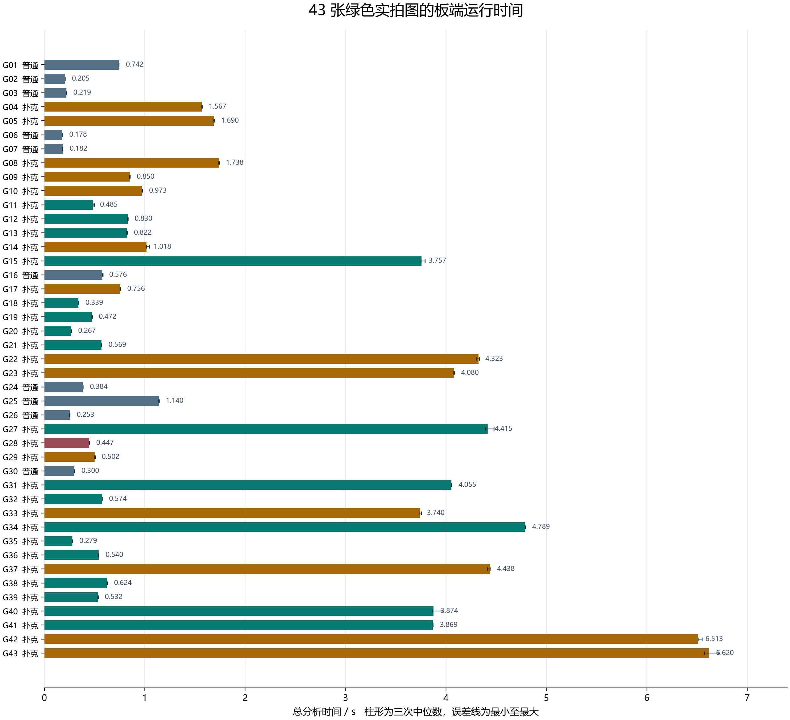

## 全部原图与拼接图

### G01 20260730_225714_149

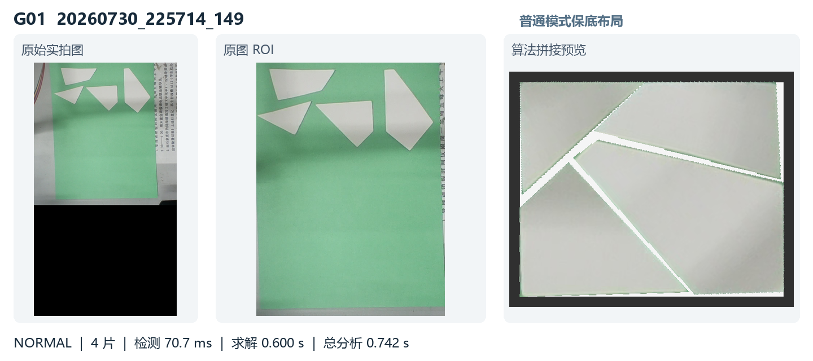

[原图 PNG](originals/20260730_225714_149_raw.png) · [拼接 PNG](assembled/20260730_225714_149.png) · [运行 JSON](records/20260730_225714_149.json)

### G02 20260730_231817_179

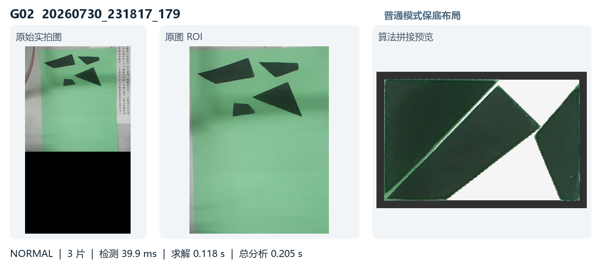

[原图 PNG](originals/20260730_231817_179_raw.png) · [拼接 PNG](assembled/20260730_231817_179.png) · [运行 JSON](records/20260730_231817_179.json)

### G03 20260730_231827_144

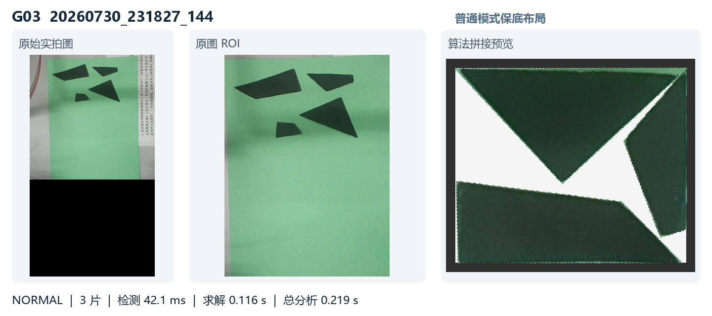

[原图 PNG](originals/20260730_231827_144_raw.png) · [拼接 PNG](assembled/20260730_231827_144.png) · [运行 JSON](records/20260730_231827_144.json)

### G04 20260731_222527_772

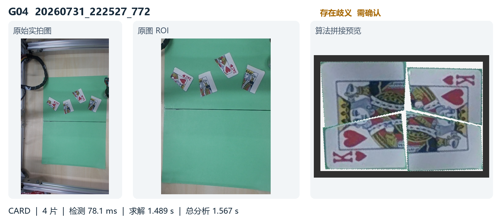

[原图 PNG](originals/20260731_222527_772_raw.png) · [拼接 PNG](assembled/20260731_222527_772.png) · [运行 JSON](records/20260731_222527_772.json)

### G05 20260731_224744_511

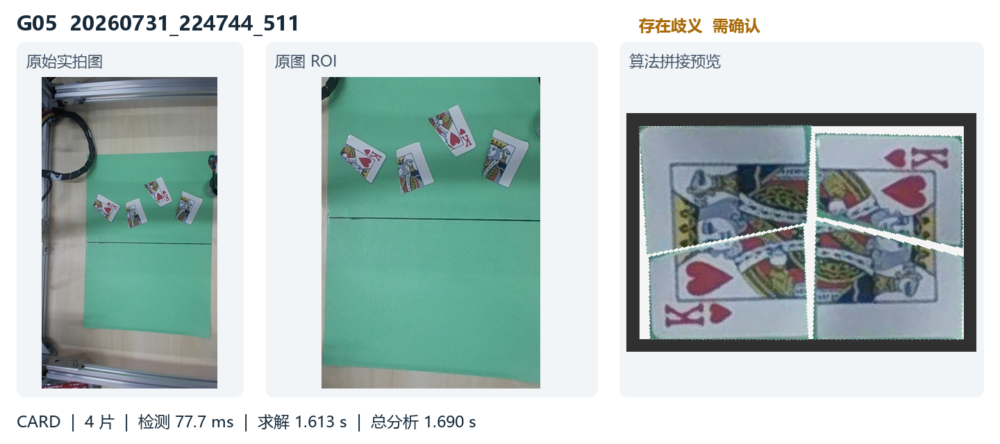

[原图 PNG](originals/20260731_224744_511_raw.png) · [拼接 PNG](assembled/20260731_224744_511.png) · [运行 JSON](records/20260731_224744_511.json)

### G06 20260731_230438_607

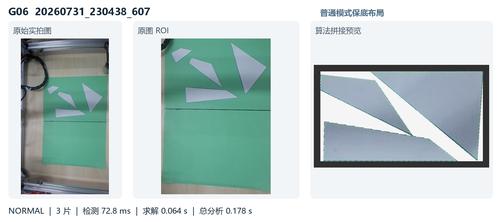

[原图 PNG](originals/20260731_230438_607_raw.png) · [拼接 PNG](assembled/20260731_230438_607.png) · [运行 JSON](records/20260731_230438_607.json)

### G07 20260731_230559_738


[原图 PNG](originals/20260731_230559_738_raw.png) · [拼接 PNG](assembled/20260731_230559_738.png) · [运行 JSON](records/20260731_230559_738.json)

### G08 20260801_013943_516

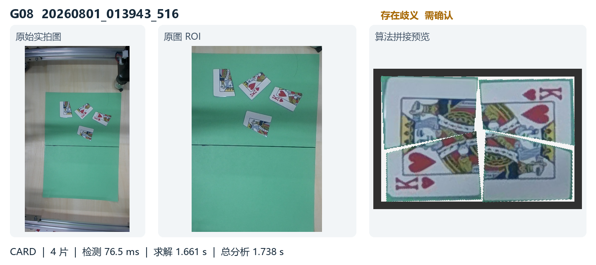

[原图 PNG](originals/20260801_013943_516_raw.png) · [拼接 PNG](assembled/20260801_013943_516.png) · [运行 JSON](records/20260801_013943_516.json)

### G09 20260801_013955_116

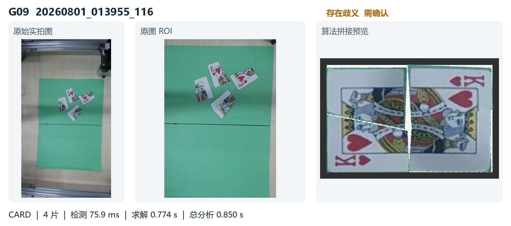

[原图 PNG](originals/20260801_013955_116_raw.png) · [拼接 PNG](assembled/20260801_013955_116.png) · [运行 JSON](records/20260801_013955_116.json)

### G10 20260801_014022_101

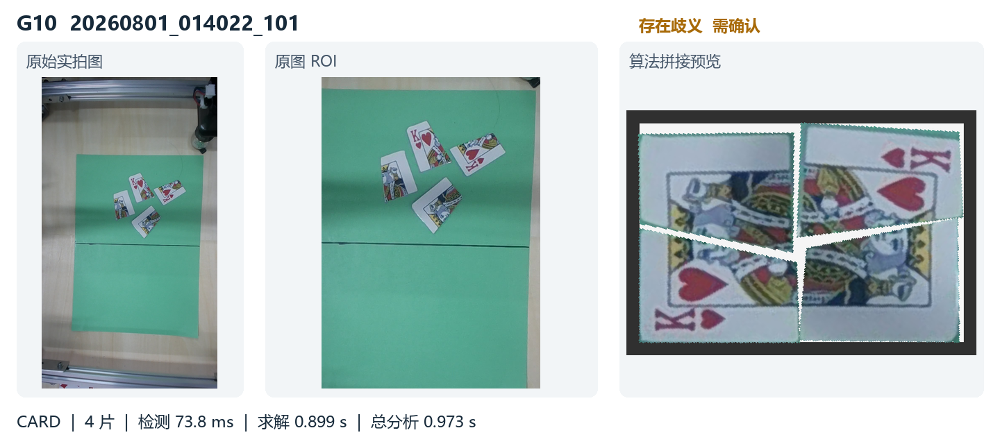

[原图 PNG](originals/20260801_014022_101_raw.png) · [拼接 PNG](assembled/20260801_014022_101.png) · [运行 JSON](records/20260801_014022_101.json)

### G11 20260801_014027_873

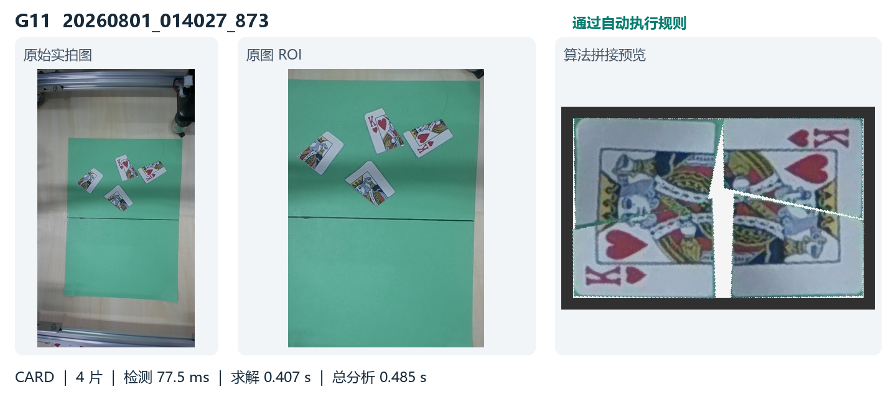

[原图 PNG](originals/20260801_014027_873_raw.png) · [拼接 PNG](assembled/20260801_014027_873.png) · [运行 JSON](records/20260801_014027_873.json)

### G12 20260801_014047_329

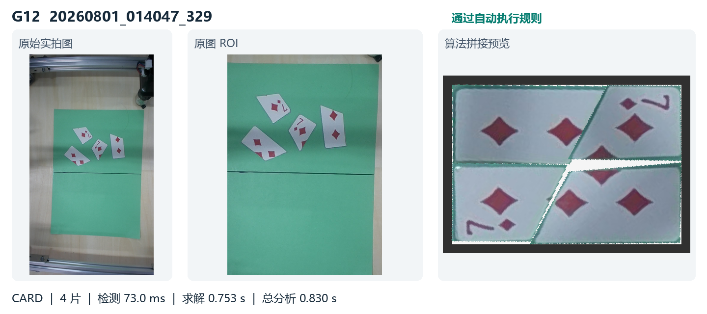

[原图 PNG](originals/20260801_014047_329_raw.png) · [拼接 PNG](assembled/20260801_014047_329.png) · [运行 JSON](records/20260801_014047_329.json)

### G13 20260801_014107_758

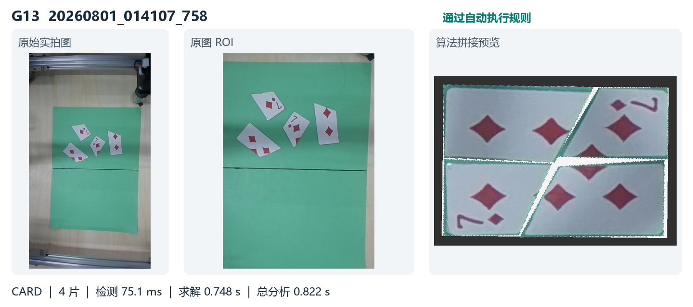

[原图 PNG](originals/20260801_014107_758_raw.png) · [拼接 PNG](assembled/20260801_014107_758.png) · [运行 JSON](records/20260801_014107_758.json)

### G14 20260801_014147_961

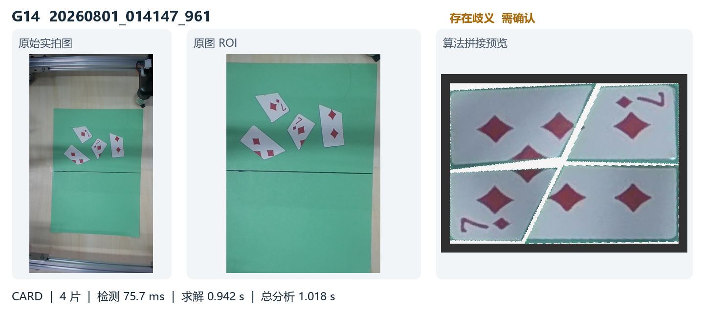

[原图 PNG](originals/20260801_014147_961_raw.png) · [拼接 PNG](assembled/20260801_014147_961.png) · [运行 JSON](records/20260801_014147_961.json)

### G15 20260801_032606_145

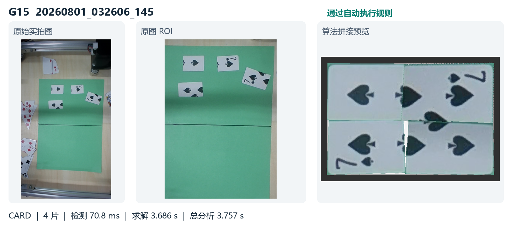

[原图 PNG](originals/20260801_032606_145_raw.png) · [拼接 PNG](assembled/20260801_032606_145.png) · [运行 JSON](records/20260801_032606_145.json)

### G16 20260801_032800_758

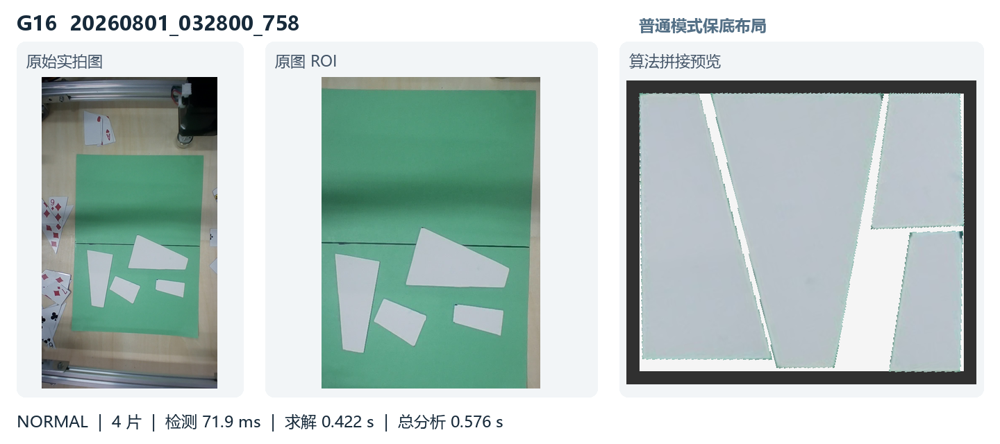

[原图 PNG](originals/20260801_032800_758_raw.png) · [拼接 PNG](assembled/20260801_032800_758.png) · [运行 JSON](records/20260801_032800_758.json)

### G17 20260801_045442_457

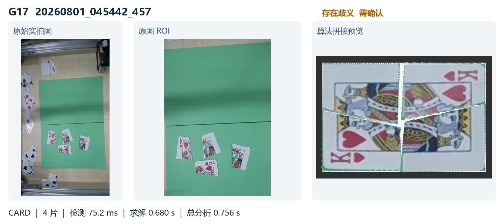

[原图 PNG](originals/20260801_045442_457_raw.png) · [拼接 PNG](assembled/20260801_045442_457.png) · [运行 JSON](records/20260801_045442_457.json)

### G18 20260801_060309_056

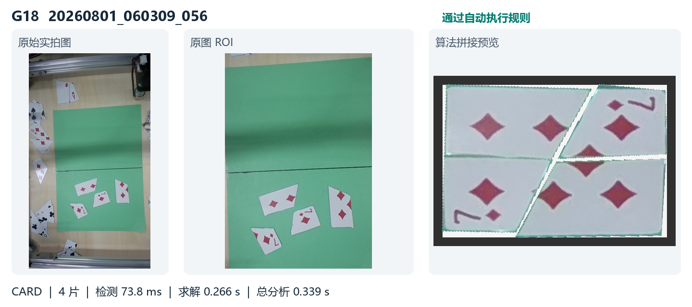

[原图 PNG](originals/20260801_060309_056_raw.png) · [拼接 PNG](assembled/20260801_060309_056.png) · [运行 JSON](records/20260801_060309_056.json)

### G19 20260801_062401_006

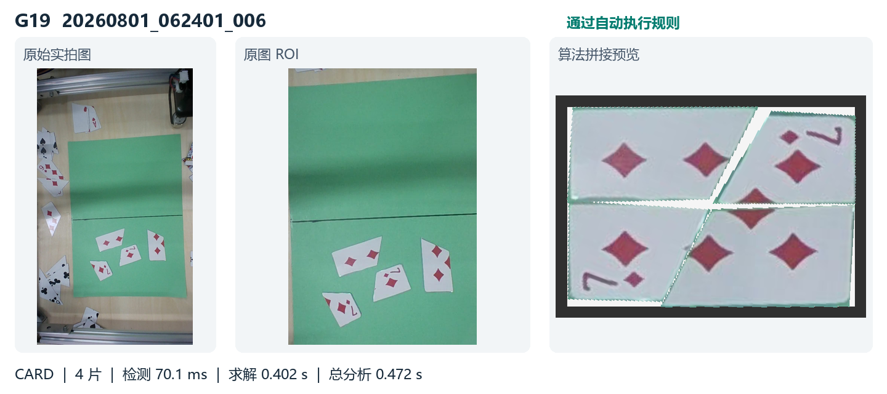

[原图 PNG](originals/20260801_062401_006_raw.png) · [拼接 PNG](assembled/20260801_062401_006.png) · [运行 JSON](records/20260801_062401_006.json)

### G20 20260801_062529_588


[原图 PNG](originals/20260801_062529_588_raw.png) · [拼接 PNG](assembled/20260801_062529_588.png) · [运行 JSON](records/20260801_062529_588.json)

### G21 20260801_065112_551

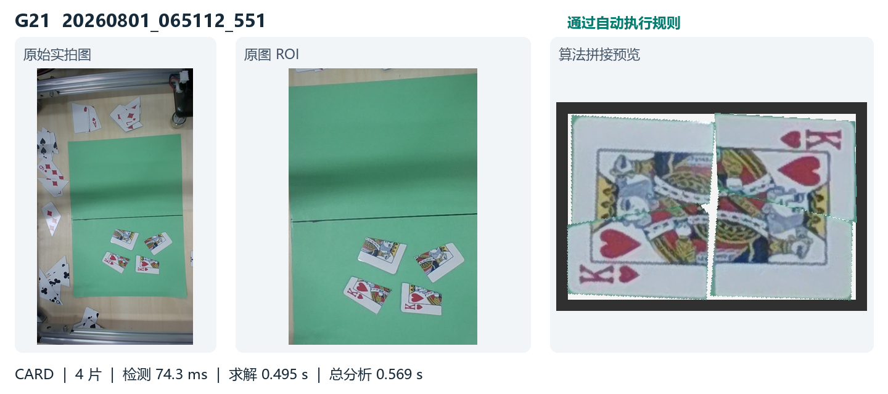

[原图 PNG](originals/20260801_065112_551_raw.png) · [拼接 PNG](assembled/20260801_065112_551.png) · [运行 JSON](records/20260801_065112_551.json)

### G22 20260801_115637_683

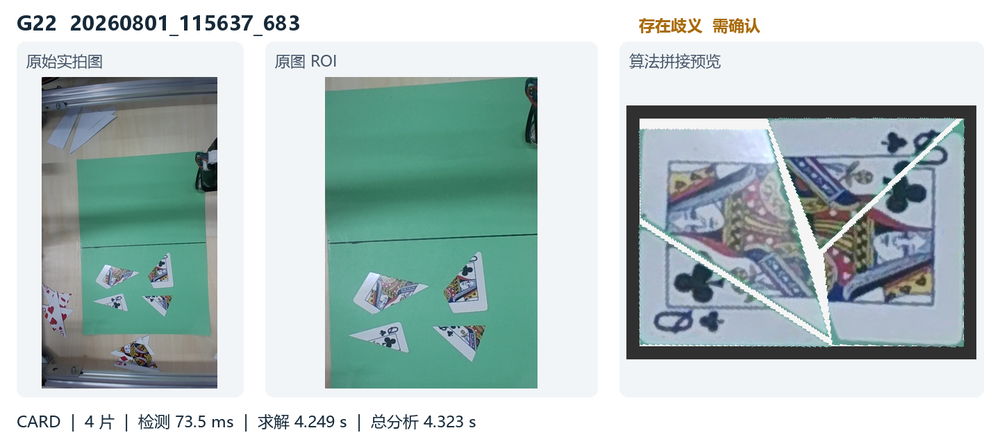

[原图 PNG](originals/20260801_115637_683_raw.png) · [拼接 PNG](assembled/20260801_115637_683.png) · [运行 JSON](records/20260801_115637_683.json)

### G23 20260801_115701_361

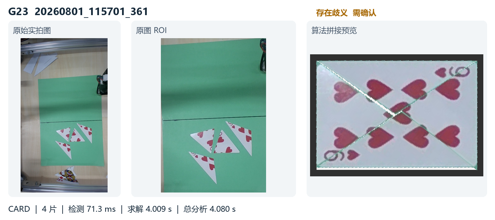

[原图 PNG](originals/20260801_115701_361_raw.png) · [拼接 PNG](assembled/20260801_115701_361.png) · [运行 JSON](records/20260801_115701_361.json)

### G24 20260801_115722_048

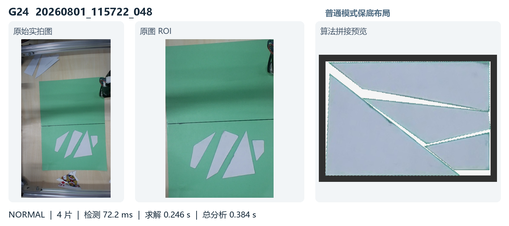

[原图 PNG](originals/20260801_115722_048_raw.png) · [拼接 PNG](assembled/20260801_115722_048.png) · [运行 JSON](records/20260801_115722_048.json)

### G25 20260801_121207_250

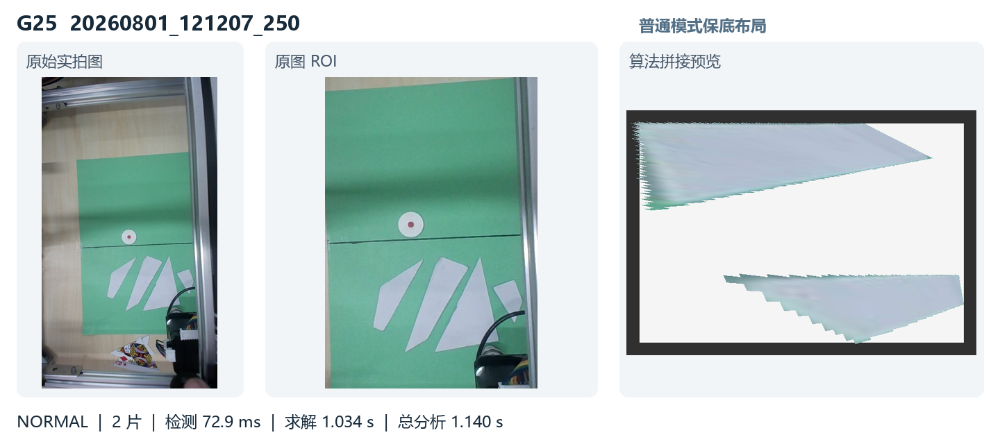

[原图 PNG](originals/20260801_121207_250_raw.png) · [拼接 PNG](assembled/20260801_121207_250.png) · [运行 JSON](records/20260801_121207_250.json)

### G26 20260801_184457_395

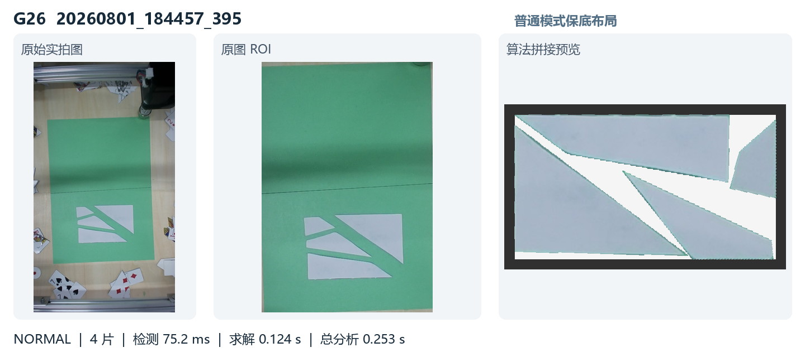

[原图 PNG](originals/20260801_184457_395_raw.png) · [拼接 PNG](assembled/20260801_184457_395.png) · [运行 JSON](records/20260801_184457_395.json)

### G27 20260801_185703_491

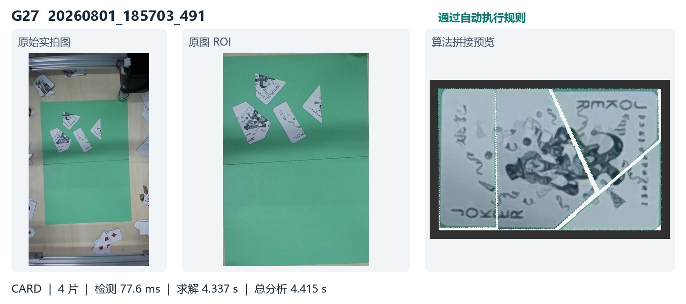

[原图 PNG](originals/20260801_185703_491_raw.png) · [拼接 PNG](assembled/20260801_185703_491.png) · [运行 JSON](records/20260801_185703_491.json)

### G28 20260801_192239_246

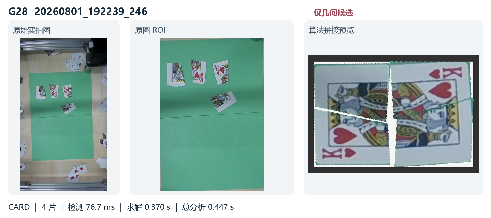

[原图 PNG](originals/20260801_192239_246_raw.png) · [拼接 PNG](assembled/20260801_192239_246.png) · [运行 JSON](records/20260801_192239_246.json)

### G29 20260801_192916_754

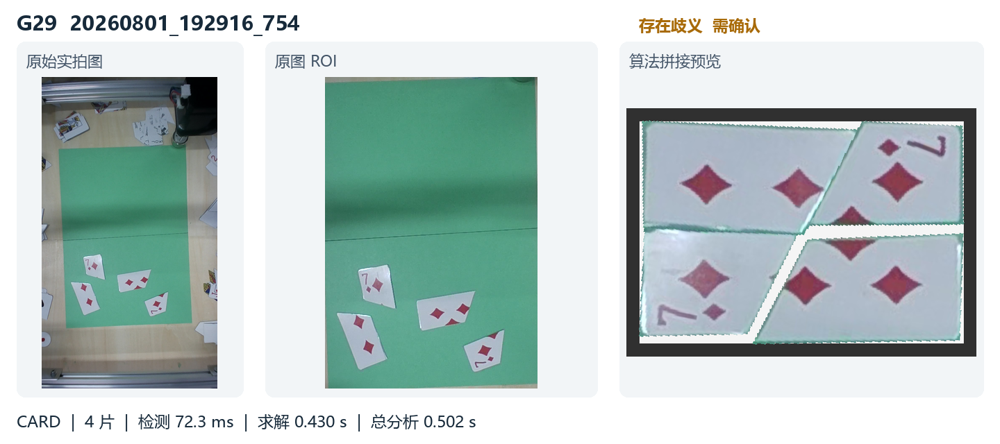

[原图 PNG](originals/20260801_192916_754_raw.png) · [拼接 PNG](assembled/20260801_192916_754.png) · [运行 JSON](records/20260801_192916_754.json)

### G30 20260801_214215_813

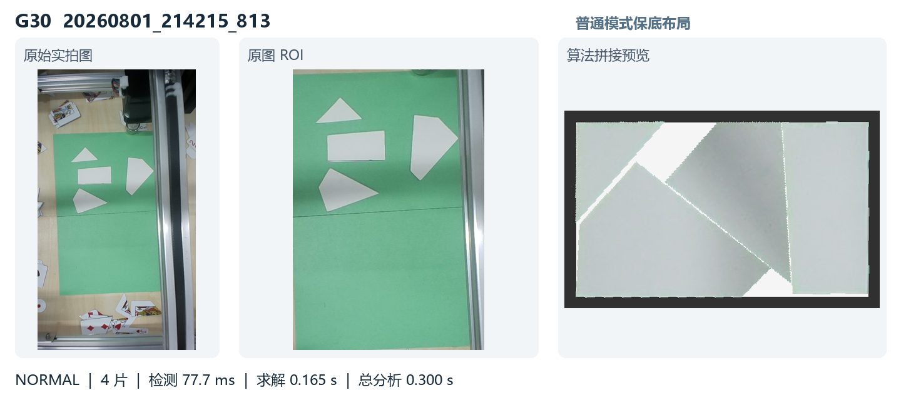

[原图 PNG](originals/20260801_214215_813_raw.png) · [拼接 PNG](assembled/20260801_214215_813.png) · [运行 JSON](records/20260801_214215_813.json)

### G31 20260801_215755_916


[原图 PNG](originals/20260801_215755_916_raw.png) · [拼接 PNG](assembled/20260801_215755_916.png) · [运行 JSON](records/20260801_215755_916.json)

### G32 20260801_215940_303

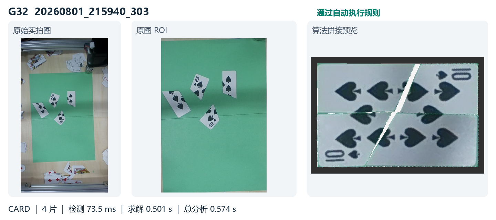

[原图 PNG](originals/20260801_215940_303_raw.png) · [拼接 PNG](assembled/20260801_215940_303.png) · [运行 JSON](records/20260801_215940_303.json)

### G33 20260801_224410_692

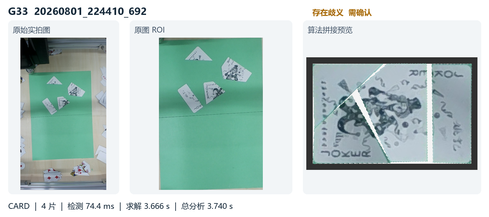

[原图 PNG](originals/20260801_224410_692_raw.png) · [拼接 PNG](assembled/20260801_224410_692.png) · [运行 JSON](records/20260801_224410_692.json)

### G34 20260801_224437_055

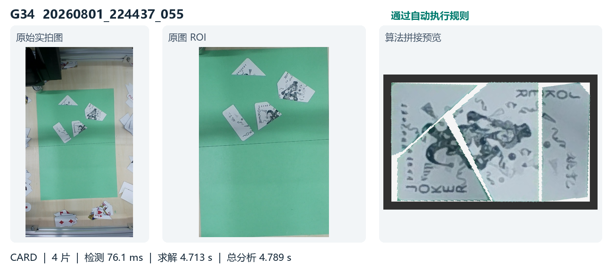

[原图 PNG](originals/20260801_224437_055_raw.png) · [拼接 PNG](assembled/20260801_224437_055.png) · [运行 JSON](records/20260801_224437_055.json)

### G35 20260801_225239_323

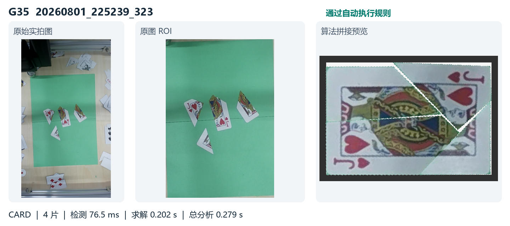

[原图 PNG](originals/20260801_225239_323_raw.png) · [拼接 PNG](assembled/20260801_225239_323.png) · [运行 JSON](records/20260801_225239_323.json)

### G36 20260801_225517_181

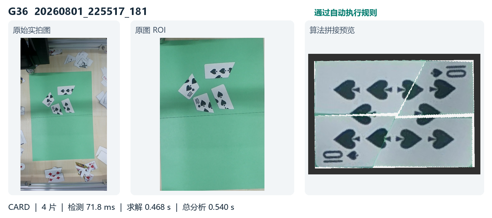

[原图 PNG](originals/20260801_225517_181_raw.png) · [拼接 PNG](assembled/20260801_225517_181.png) · [运行 JSON](records/20260801_225517_181.json)

### G37 20260801_225637_008

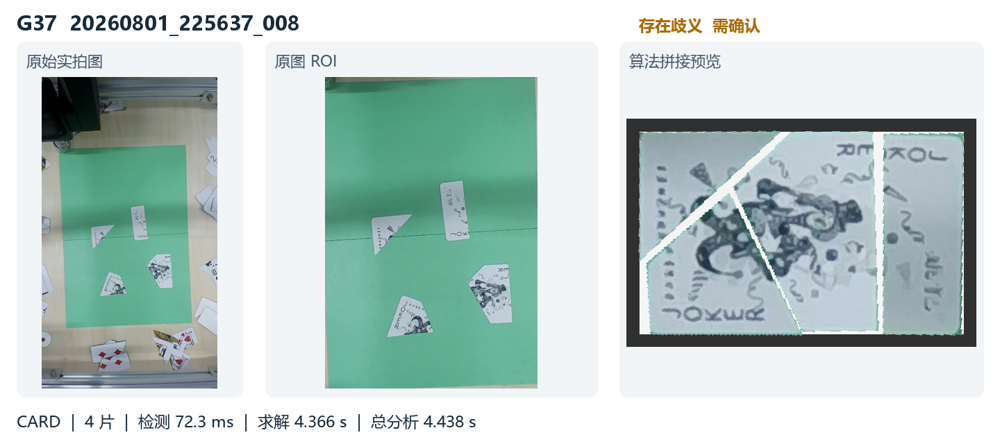

[原图 PNG](originals/20260801_225637_008_raw.png) · [拼接 PNG](assembled/20260801_225637_008.png) · [运行 JSON](records/20260801_225637_008.json)

### G38 20260802_013324_510

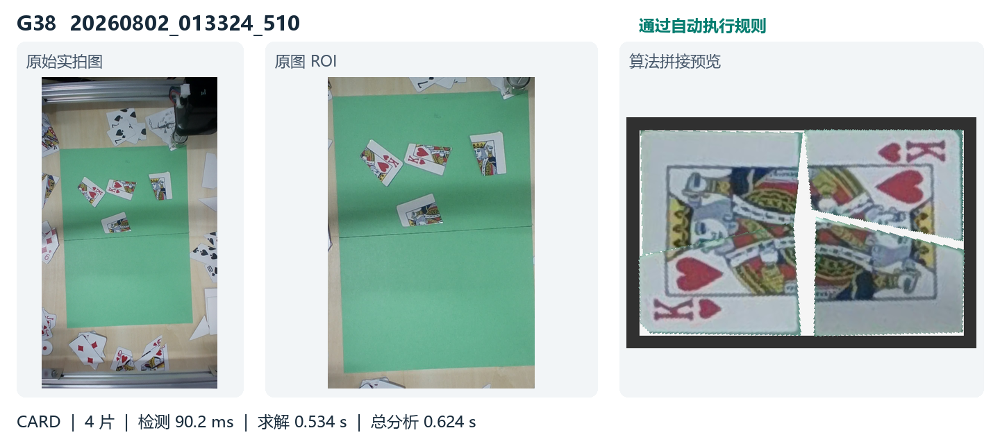

[原图 PNG](originals/20260802_013324_510_raw.png) · [拼接 PNG](assembled/20260802_013324_510.png) · [运行 JSON](records/20260802_013324_510.json)

### G39 20260802_014532_605

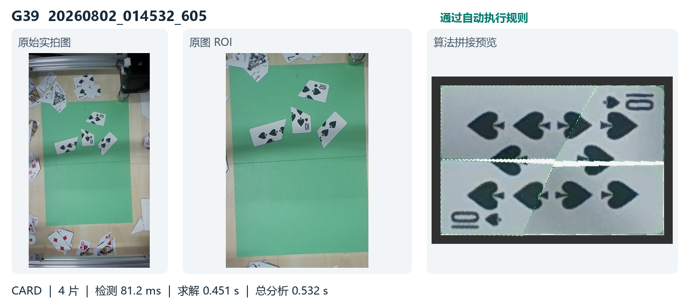

[原图 PNG](originals/20260802_014532_605_raw.png) · [拼接 PNG](assembled/20260802_014532_605.png) · [运行 JSON](records/20260802_014532_605.json)

### G40 20260802_014544_004

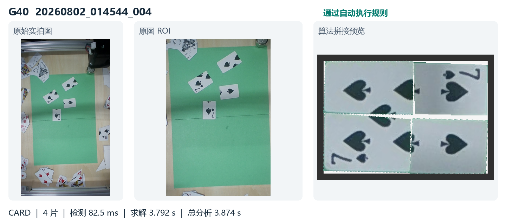

[原图 PNG](originals/20260802_014544_004_raw.png) · [拼接 PNG](assembled/20260802_014544_004.png) · [运行 JSON](records/20260802_014544_004.json)

### G41 20260802_014700_604

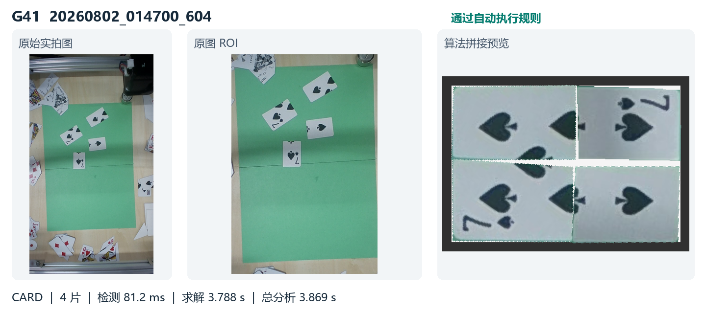

[原图 PNG](originals/20260802_014700_604_raw.png) · [拼接 PNG](assembled/20260802_014700_604.png) · [运行 JSON](records/20260802_014700_604.json)

### G42 20261016_213503_271


[原图 PNG](originals/20261016_213503_271_raw.png) · [拼接 PNG](assembled/20261016_213503_271.png) · [运行 JSON](records/20261016_213503_271.json)

### G43 20261016_213811_526

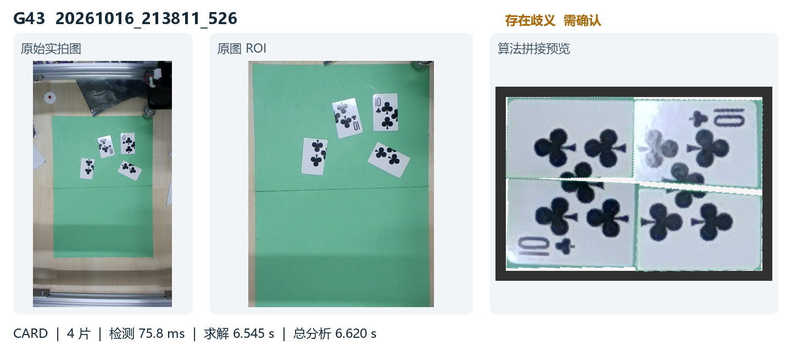

[原图 PNG](originals/20261016_213811_526_raw.png) · [拼接 PNG](assembled/20261016_213811_526.png) · [运行 JSON](records/20261016_213811_526.json)

